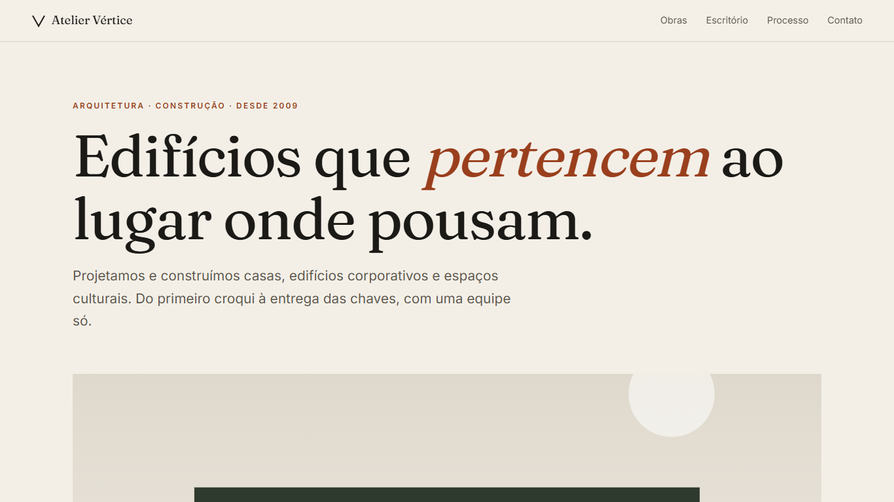
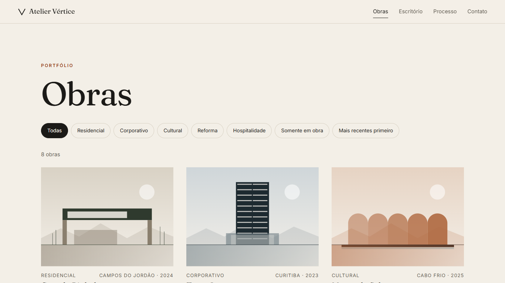
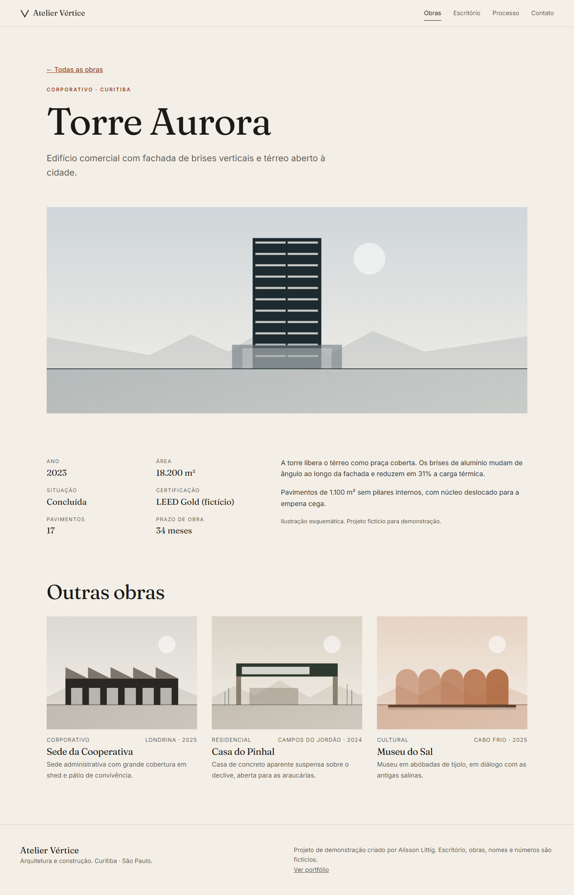
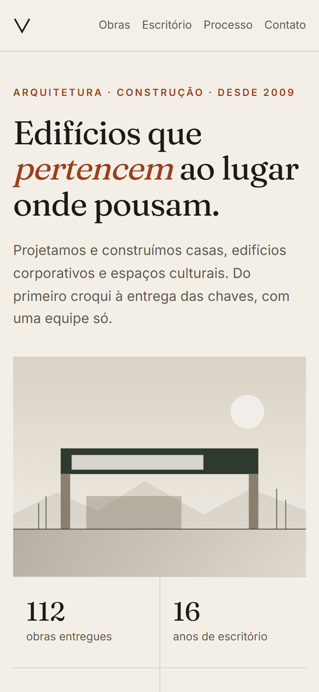

# Atelier Vértice

Multi-page website for a fictional architecture and construction firm: portfolio of works with filters, project pages, about, process and contact. Editorial look, built with Astro as a static site.

**Live demo:** https://alissonlittig.github.io/atelier-vertice/

> Demo project. The firm, people, works, numbers and address are fictional. The contact form does not send data. Building illustrations are generated SVG elevations (no photos).

| Home | Works (filters) |
|---|---|
|  |  |

| Project page | Mobile (390px) |
|---|---|
|  |  |

## Features
- 8 projects in 5 typologies; filter by typology, "under construction" only, and sort by year (no page reload, graceful without JS).
- One static page per project, generated from `src/data/obras.ts`.
- Procedural SVG building elevations per project, so the site ships no raster images.
- Responsive down to 390px with no horizontal scroll; AA contrast, skip link, visible focus, reduced-motion support.
- Lighthouse (local, desktop defaults): Performance 99-100, Accessibility 98-100, Best Practices 100, SEO 100.

## Stack
Astro 5, TypeScript, plain CSS, self-hosted variable fonts (Fraunces, Inter). Deployed to GitHub Pages with GitHub Actions.

## Run
```bash
npm install
npm run dev      # http://localhost:4321/atelier-vertice/
npm run build    # static output in dist/
```

## Structure
```
src/data/obras.ts       project data
src/components/         Obra (SVG illustration), Card
src/pages/              home, obras (list + [slug]), sobre, processo, contato, 404
src/styles/global.css   design tokens and layout
```

Part of the portfolio at https://alissonlittig.github.io/ by Alisson Littig.
